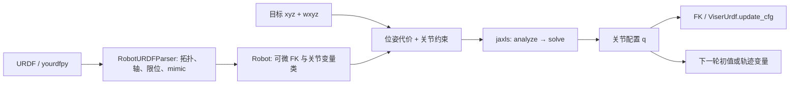

# PyRoki 源码学习分析

日期：2026-10-06。源码基线：`388e43e1fc0d0ee382968d3dd72970fd62a0450c`，学习分支：`codex/study/pyroki-code-analysis`。

本次工作是完整 Python 源码注释与静态阅读。48 个原始 Python 文件均保留全部原始行，仅插入中文整行注释；也保留已停用的批量 URDF 渲染实现。结论依据当前本地源码，不把示例、历史基准表或原有说明当作已经复现的结果。可用 [审查脚本](verify_annotations.py) 重复检查基线等价性，范围记录在 [annotation_scope.json](annotation_scope.json)。

## 先建立主调用链

建议从 [01_basic_ik.py](../examples/01_basic_ik.py) 开始，把下面五个阶段串起来，而不是先阅读复杂重定向示例。

1. **URDF 加载**：`load_robot_description("panda_description")` 得到 `yourdfpy.URDF`。它可能依赖外部模型资源；本次没有执行加载或下载。自定义 URDF 的替代写法已在示例保留。
2. **机器人结构**：[Robot.from_urdf](../src/pyroki/_robot.py) 调用 [RobotURDFParser.parse](../src/pyroki/_robot_urdf_parser.py)，提取 origin、轴、父关节索引、直接驱动/mimic 映射、位置/速度范围与拓扑排序。默认关节初值为上下限中点，并创建捕获该初值的 `JointVar` 类型。
3. **目标与变量**：[solve_ik](../examples/pyroki_snippets/_solve_ik.py) 校验目标位置 `(3,)`、姿态 `(4,)`，把连杆名称变为索引。`JointVar(0)` 代表一套待优化关节配置，目标由 `jaxlie.SO3(wxyz)` 和 xyz 组成 `SE3`。
4. **代价与约束**：最小示例使用 `pose_cost_analytic_jac`（位置/旋转残差权重 50/10）和 `limit_constraint`。前者控制末端目标，后者使用所有关节展开后的越界残差。`LeastSquaresProblem(...).analyze().solve(...)` 负责优化；稠密 Cholesky 是线性子问题的选项，不是闭式 IK。
5. **显示**：读取 `sol[joint_var]`，转换为 NumPy 后交给 `ViserUrdf.update_cfg`。显示配置与发送真实机器人命令是不同操作：该示例没有机器人控制连接。

这里的“世界坐标”需要逐层确认。纯 `Robot.forward_kinematics` 把根连杆设为单位位姿，得到基座相对的连杆变换。移动基座和重定向示例另以 `T_world_base @ T_base_link` 或 `T_world_root @ T_root_link` 放到外部世界坐标。

## 核心文件的分工

| 文件或目录 | 学习时抓住的输入→输出 | 主要连接 |
|---|---|---|
| [src/pyroki/_robot_urdf_parser.py](../src/pyroki/_robot_urdf_parser.py) | URDF→`JointInfo` / `LinkInfo` | 解析拓扑、关节单位和 mimic 关系 |
| [src/pyroki/_robot.py](../src/pyroki/_robot.py) | 直接驱动配置→所有连杆 SE(3) | IK、Jacobian、碰撞均依赖 FK |
| [src/pyroki/_residuals/_residuals.py](../src/pyroki/_residuals/_residuals.py) | `VarValues`→加权残差向量 | 位姿、限位、平滑、可操作度、碰撞 |
| [src/pyroki/_residuals/_pose_residual_analytic_jac.py](../src/pyroki/_residuals/_pose_residual_analytic_jac.py) | FK 缓存→`6 × N_act` 残差 Jacobian | 祖先路径、mimic 导数汇总、SE(3) `jlog` |
| [src/pyroki/_residuals/_pose_residual_numerical_jac.py](../src/pyroki/_residuals/_pose_residual_numerical_jac.py) | 单关节扰动→有限差分 Jacobian | 对照解析/自动微分的含义与开销 |
| [src/pyroki/costs.py](../src/pyroki/costs.py) | 纯残差函数→`Cost.factory` 工厂 | 同一残差可包装为软项或约束 |
| [src/pyroki/collision/](../src/pyroki/collision/) | 局部近似几何+FK→有向距离 | 自碰撞活动对、世界对象矩阵、扫掠近似 |
| [examples/pyroki_snippets/](../examples/pyroki_snippets/) | 可运行问题组装方式 | 一目标、多目标、基座、轨迹、速度 IK |
| [src/pyroki/viewer/](../src/pyroki/viewer/) | 配置/权重→诊断显示 | Viser 权重滑块与平移可操作椭球 |
| [tests/test_ik_vmap.py](../tests/test_ik_vmap.py) | 批对象/批目标→形状断言 | 展示 `in_axes` 与静态拓扑边界 |
| [benchmark/ik_benchmark.py](../benchmark/ik_benchmark.py) | 多初值 IK→时间/误差统计 | 单独依赖 cuRobo、Torch、模型资源 |
| [docs/](../docs/) | 文档构建与示例提取 | 不属于机器人求解过程 |

PyRoki 提供 FK、几何和残差；迭代求解器来自外部 `jaxls`。当前 [pyproject.toml](../pyproject.toml) 将 `jaxls` 指向 Git 仓库而非固定 commit，因此还不能仅凭本仓库基线复现求解器版本。

## 数组、坐标和单位约定

| 对象 | 当前源码中的轴或顺序 | 需要避免的混淆 |
|---|---|---|
| 直接驱动配置 `cfg` | `(*batch, N_act)` | 不包含额外 fixed/mimic 自由变量 |
| 全关节配置 | `(*batch, N_joint)` | `get_full_config` 应用 mimic 的 `multiplier*q+offset` |
| FK 连杆结果 | `(*batch, N_link, 7)`，末轴 `w,x,y,z,x,y,z` | 四元数为 **wxyz**；后 3 项才是平移 xyz |
| SE(3) 切向量 / twist | 前 3 项线分量，后 3 项角分量 | 7 维 pose 表示与 6 维 `log` 残差不同 |
| 平移 Jacobian | `(3, N_act)` | 当前可操作度只考虑平移 |
| 位姿残差 Jacobian | `(6, N_act)` | 解析路径先计算几何导数，再乘误差 `jlog` |
| 多目标输入 | 位置 `(N_target,3)`、姿态 `(N_target,4)` | 相同变量 ID=0 表示共同约束一套配置 |
| 轨迹 | `(T, N_act)`，变量 ID 为 `0..T-1` | 不同 ID 表示不同时间状态，不能只把 T 当作独立 batch |
| 碰撞距离 | 自碰撞 `(*batch,N_pair)`；世界 `(*batch,N_geom,N_world)` | N_geom 与 N_link 在球分解模式下不同 |
| 高度图 | 末两轴 `(H,W)` 对应局部 y/x | 采样为中心化网格，距离往往是局部 z 近似 |

按 URDF 常用约定，旋转关节值为弧度，移动关节/平移/半径/安全距离为米；本实现不会替你识别或转换自定义资源的单位。若 URDF、人体关键点、世界几何和控制周期尺度不一致，求出的数值可能合理却没有正确物理意义。速度限位残差除以 `dt`，单位随关节为 rad/s 或 m/s；普通 `smoothness_residual` 只惩罚配置差，没有除 `dt`。

`log(actual.inverse() @ target)` 的前三项是 SE(3) 切空间平移误差；同时有旋转误差时，它不等于直接世界 xyz 相减。纯残差位姿路径与解析/数值自定义路径采用相反的相对变换顺序，读 Jacobian 时应跟随对应残差表达式。

## JAX 与变量批化的阅读方法

- `jax_dataclasses` 的 PyTree 把数值数组作为叶节点，把名称、数量和拓扑索引等 `jdc.Static` 值作为结构。`jax.tree.map(lambda x: x[None], robot)` 只给数值叶节点加批轴。
- `@jdc.jit` 将 FK/求解函数编译；首次调用以及形状或静态结构变化时可能产生编译开销。本次没有测量编译或运行时间。
- 基本 IK 的 `vmap(..., in_axes=(None,None,0,0))` 表示共享机器人/连杆索引、逐目标独立求解；多目标示例里的重复 `JointVar(0)` 则表示多个目标共享一个优化配置。这两种“批”有不同建模含义。
- 轨迹用递增变量 ID 建立不同时间点，再用 prev/next ID 数组把相邻项连接。重定向里的尺度变量反而重复 ID=0，以跨帧共享同一尺度矩阵。
- [vmap 测试](../tests/test_ik_vmap.py) 明确展示：同批可变化数值参数，但静态拓扑不同的碰撞对象不能直接堆叠。测试大多验证形状与结构，不等于验证精度、碰撞安全或收敛。
- JAX 设备计算可异步提交。[benchmark](../benchmark/ik_benchmark.py) 使用 `jax.block_until_ready` 将编译预热与计时分开；普通 `time.time` 包围调用不自动保证设备已完成。

## 代价、约束与算法差别

`costs.py` 让一个残差函数既可用于软惩罚，也可由 `kind="constraint_leq_zero"` 转为不等式约束。软项表达偏好，约束表达应满足的关系；是否收敛到约束精度仍需看外部求解器设置与运行证据。

当前关节越界残差实际上为 `max(0, upper_violation)` / `max(0, lower_violation)`，范围内返回零。原有部分 docstring 写“满足时为负”，应以实现为准。`colldist_from_sdf` 返回非正安全距离激活，核心碰撞 residual 再取负，因此有效安全状态为零、违例为正。轨迹扫掠因子直接返回 `signed_distance - margin`，相应使用 `constraint_geq_zero`。

| 示例路线 | 核心问题 | 约束/方法差别 |
|---|---|---|
| 01→02→03 | 单目标、共同双目标、移动基座 | 非线性位姿 IK；基座通过自定义 retract 固定指定轴 |
| 04→05 | 碰撞与冗余姿态偏好 | 世界碰撞可作为约束；平移可操作度为软项 |
| 06→07 | 短时在线规划与整段轨迹优化 | 06 倾向有限迭代软项；07 加端点/速度/扫掠约束 |
| 08→13 | mimic 与锁关节 | mimic 是结构线性关联；锁关节示例屏蔽雅可比列并在输出恢复旧值 |
| 09→10→11→12 | 手/人形动作重定向 | 基础局部/全局几何匹配逐步加入接触和场景项 |
| 14 | 近奇异位置的速度 IK | SVD/伪逆、零空间、单步 Euler，独立于 jaxls 批轨迹优化 |

## 值得先记下的上游边界

这些是源代码审阅发现或原 README 限制，不是本次修改；全部实现保持原样。

1. **结构与资源**：只建模运动学树，原 README 不支持闭链。解析器只为 revolute/continuous/prismatic/fixed 建对应 twist；unsupported 类型先给零 twist，但后续限位读取仍可能拒绝缺失数据。mimic 引用直接用 `urdf.actuated_joints.index(...)` 查找，没有递归解析 mimic 链。`Robot.from_urdf` 的初值类型说明有批前缀，实际断言只接受一维 `(N_act,)`。
2. **碰撞近似**：自动模式每 link 一枚包围胶囊，球分解模式由 JSON 提供多个球。虽然原 README 的几何列表未列 Box，当前源码确有 Box 和部分类型对；Box–Box 等未登记组合仍抛错。高度图球距离为垂直近似，胶囊只看两端，可能漏中段。球心在盒内时，球盒 helper 没加最近面的穿透深度；胶囊盒只有两次最近点细化。
3. **扫掠与静态 batch**：胶囊扫掠固定取 5 个轴向球，并连接前后中心。它不构造整个非线性关节运动的完整连续包络。`Capsule.from_sphere_pairs` 的退化检测 `allclose` 是全批归约，且只取首球半径。高度图批量构造/网格分支有形状限制，需未来运行验证。
4. **示例假设**：Fetch 权重依赖 torso_lift 固定索引；重定向连接工具把传入 link 索引用于 joint 父链，依赖编号匹配；G1 名称映射也依赖固定列表。简版 09/10 虽读取接触数据，求解未添加对应接触因子。进阶人形脚位置残差已平方，最小二乘将形成四次位置惩罚；其共享 OffsetVar 声明与滑步因子逐时间 ID 引用需单独核对。
5. **锁定与误差显示**：mask 只屏蔽解析位姿因子的列，其他因子仍可作用该关节，13 示例因此在输出端再次恢复锁定关节。13 的误差 GUI 标签写 m，但更新乘了 1000；其指标取 SE(3) log 平移项，也不严格等于任意姿态差下的世界位置欧氏距离。
6. **速度 IK 与重定向**：J-PARSE 未为全零 Jacobian/gamma=0 的分母提供额外保护；四元数也需要非零有效输入。手部接触函数原注释描述 J/P 轴，实际预处理每帧传 `(C,3)` 点与 `(C,)` 索引/掩码。简版和手部重定向声明 OffsetVar 却未在因子中使用，不能把它称为已由观测约束的优化量。
7. **工具副作用**：`docs/update_example_docs.py` 会删除重建已生成文档目录；benchmark 导入即建立模型 helper，且默认主入口关闭碰撞。原基准表不能作为碰撞性能或当前硬件结果。`viewer/_batched_urdf.py` 整段被上游注释停用，本次没有启用。

## 接到 Isaac ROS 与 UnifoLM-WLA

这条路线是知识与接口上的连接，不是三个仓库现成的代码依赖。

| 学习对象 | 对下一阶段提供什么 | 接口仍需明确的内容 |
|---|---|---|
| PyRoki | 关节空间、EEF 位姿、坐标变换、限位、碰撞与轨迹优化 | 机器人型号/URDF、目标参考系、单位、关节顺序 |
| Isaac ROS 学习层 | 将相机/状态/坐标树与部署节点连接到机器人系统 | 观测时间戳、TF frame、执行周期、控制接口与反馈 |
| UnifoLM-WLA | 从图像/语言/状态预测归一化动作块 | 动作统计量反归一化、本体槽位/掩码、动作表示与执行定义 |

当前本地 WLA 的 [QwenMMDiT 框架](../../unifolm-wla/unifolm_wla/model/framework/VLM4A/QwenMMDiT.py) 把图像/指令编码成 VLM 条件，再由 [MMDiT 动作头](../../unifolm-wla/unifolm_wla/model/modules/action_model/MMDiT_ActionHeader.py) 采样动作块。其默认统一动作维 54、状态维 60，不能自动等同 Panda 的关节自由度；`action_mask`、`robot_type` 和数据变换共同决定实际意义。

一种需要后续实现和验证的桥接是：观测进入策略→预测动作反归一化→按动作表示转换为绝对/相对 EEF 目标或关节目标→必要时用 PyRoki IK/轨迹约束处理→由机器人系统执行并读取反馈。若动作本来就是关节目标，就不应无条件再做 EEF IK；若是相对位姿，则先确认增量左乘/右乘及所属 frame。当前源码阅读尚未实现这条部署桥接，也没有验证实时延迟或硬件安全。

对 VLA/世界模型研究，先把这些接口约定写清，比只比较损失数值更直接：模型预测的“未来动作”要对应可解释的机器人自由度，而未来视觉变化要与执行频率、坐标和接触条件一致。

## 第一个学习实验与记录格式

第一步推荐 **01 Basic IK**，只改拖拽目标并观察 FK/IK；先不引入碰撞、重定向或 benchmark。运行前需已有 Python/JAX/PyRoki/Viser 等依赖和 Panda 模型资源；当前没有安装或确认这些运行条件。

源码阅读顺序：`01_basic_ik.py:main` → `_solve_ik.py:solve_ik/_solve_ik_jax` → `_robot.py:from_urdf/forward_kinematics` → `_robot_urdf_parser.py:parse` → `_pose_residual_analytic_jac.py` → `costs.py`。完成后再读 02/03，练习区别同变量多目标与新增基座变量。

将未来每次实验记录为：机器人/URDF 与 commit、目标 link/frame、xyz/wxyz/关节顺序与单位、初值与权重、形状、首次编译时间和稳定运行时间、最终 FK 位置/旋转误差、限位/碰撞检查、失败目标和截图。组会汇报可先用一张调用链、一张 shape/单位表、一个拖拽实例及一个失败边界展开。

## 本次验证的范围

已完成：48 个原始 Python 文件的全行中文注释，所有活动定义和停用批量渲染实现的说明；基线原行保留、只增整行注释、Python AST/token 等价、内存语法编译与注释覆盖检查。原始数据 `.pkl/.npy/.zip/.json`、许可证、工作流、依赖元数据和文档资源保持原字节。

**没有执行**：依赖安装；URDF/模型/数据下载；JAX import 或设备初始化；PyRoki 数值测试；IK/FK/碰撞求解；Viser 服务或浏览器交互；cuRobo/性能基准；Sphinx 构建或文档重建；真实机器人执行；Git 暂存、commit 或 push。静态等价验证只能证明注释没有改动已有可执行结构，不能证明上游代码在当前依赖/设备上已可运行。

## 正式报告与索引更新

[annotation_validation.json](annotation_validation.json) 是本轮正式验证入口，随 `verify_annotations.py` 重跑更新。另存的 `annotation_verification.json` 保留为上午检查快照，不作为当前持续更新报告。索引生成工具现已保存在本仓：[generate_study_index.py](generate_study_index.py)，不依赖临时目录清单。

## 2026-10-06 本地提交授权

用户已明确授权将 PyRoki、WLA 和 5 个 Isaac ROS 仓库的本轮注释、代码树及分析材料提交到各自学习分支。本文中“未提交／等待审查”描述的是准备阶段；本轮将创建本地 commit，验证仍使用固定上游基线。提交版本统一登记在学习流水线的提交记录中。运行实验尚未执行。
